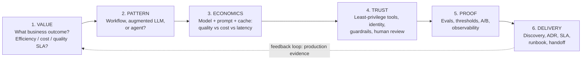

# Module 0 — Start Here: Blueprint, Mindset & Study Plans
*Read this before Module 1. It will save you weeks of unfocused studying.*

---

## 1. The human story

Meet three people who all “know Claude”:

- **Priya** can write brilliant prompts. Her demo wows everyone. In production, costs explode and nobody can prove the new prompt is better than the old one.
- **Marcus** built an agent with 22 tools “just in case”. It works — until an auditor asks why a support bot can refund payments *and* delete accounts.
- **Sofia** shipped a RAG assistant that was accurate in March. After a document refresh in April, it answers confidently with last year's policy. Users notice before the team does.

None of them lacks intelligence. They lack **architect judgment**: pattern choice, model/prompt economics, least-privilege integration, retrieval diagnosis, evaluation, governance, and delivery discipline. That is *exactly* what CCAR-P tests — and what this guide teaches, module by module.

> **The one-sentence secret of the Professional exam:** Every question describes a system that is *already failing in one specific way*, and asks for the **one most defensible change**. Three options will sound like “good practice in general”. Only one fixes *this* failure, at *this* constraint, with *this* evidence.

---

## 2. Exam blueprint (from the public course outline)

| Domain | Focus | Weight | Module |
|---|---|---|---|
| D1 | Solution Design & Architecture Patterns | 17% | 01 |
| D2 | Models, Prompting & Context Engineering | 13% | 02 |
| D3 | Integration (protocols, access, tool scope + RAG/observability) | 19% | 03 + 04 |
| D4 | Evaluation, Testing & Optimisation | 16% | 05 |
| D5 | Governance, Safety & Risk Management | 14% | 06 |
| D6 | Stakeholder Communication & Solution Delivery | 14% | 07 |
| D7 | Developer Productivity (incl. Claude Code) | 7% | 07 |
| — | Mock exam & readiness (63 Qs, 120 min, scaled pass 720) | — | 08 |

> ⚠️ **Verify:** Domain names/weights/format can change. Confirm on the official Anthropic Partner Academy exam guide before booking. Register for the real exam only via official pages (the course points there; so should you).

**What the weights tell you strategically:** Integration (19%) + Solution Design (17%) + Evaluation (16%) = **52% of your score**. If time is short, master 03/04, 01, 05 first — but don't ignore Governance (14%): it's highly learnable, rule-based marks.

### Item formats you'll meet
- **Multiple-choice (one best answer):** 4 options, all plausible. Eliminate by *failure-fit*: “Does this fix the stated failure?”
- **Multiple-response (“choose two”):** You need *both* correct; partial credit typically isn't the architect mindset — find the pair that together close the gap (e.g., a preventive control + a detective control).

---

## 3. Plain-English glossary (beginner foundation — no shame, start here)

| Term | Human explanation | Analogy |
|---|---|---|
| **LLM / Claude model** | A model that predicts good text (and tool calls) from context | A very well-read colleague who answers from what you put in front of them |
| **Augmented LLM** | One model call enriched with retrieval, tools, or memory | Colleague + filing cabinet + calculator |
| **Workflow** | *You* predefine the steps; the model fills steps in | Assembly line |
| **Agent** | The *model* decides next steps in a loop until done | Trusted employee with a goal and a budget |
| **System prompt** | Standing instructions: role, rules, guardrails, output format | Employee handbook |
| **Context window** | Everything the model can “see” in one request (tokens) | Desk size — bigger desk ≠ better work |
| **Token** | Chunk of text the model counts/bills by (~¾ of a word in English, varies) | Taxi meter units |
| **Prompt caching** | Reuse a repeated prompt prefix cheaply instead of re-paying full price | Photocopying the handbook instead of re-typing it |
| **Tool / function calling** | Model asks your code to do something (search, refund, query DB) | Colleague filing a request form; *your* system executes it |
| **MCP (Model Context Protocol)** | Standard way to expose tools/resources/prompts to models/agents | USB standard for AI tools |
| **RAG** | Retrieve relevant documents, then generate an answer grounded in them | Open-book exam |
| **Chunking** | Splitting documents into retrievable pieces | Index cards vs whole encyclopaedia |
| **Embedding / vector index** | Numbers capturing meaning, so “similar meaning” is searchable | Filing cards by *topic*, not just keywords |
| **Reranking** | Re-ordering retrieved chunks by true relevance to the question | Shortlisting CVs, then interviewing the top few |
| **Eval** | A repeatable test that scores model/system behaviour | Unit tests + exams for AI |
| **Grader** | Who/what scores an eval: code, rules, human, or model-as-judge | Exam marker |
| **Hallucination** | Fluent, confident, unsupported/wrong output | Confident bluffing |
| **Guardrail** | A control that prevents/detects/contains bad behaviour | Seatbelt, airbag, and speed camera — different layers |
| **Human-in-the-loop (HITL)** | A human reviews/approves at a defined point | Four-eyes principle for payments |
| **ADR** | Architecture Decision Record: context, decision, consequences | Meeting minutes that future-you will thank you for |
| **SLA / SLO** | Promised service level (contract) / internal objective (target) | Delivery promise vs kitchen timer |
| **Claude Code** | Anthropic's agentic coding tool for developer workflows | Pair-programmer in the terminal |

---

## 4. The architect's mental operating system (used in every module)

For *any* scenario, run this 6-step loop — on paper, in labs, and in the exam:

**Memorise this loop.** Most exam stems hide which step is broken. Your job: name the broken step, pick the fix for *that* step.

---

## 5. Study plans (pick one honestly)

### Plan A — 14-Day Sprint (you already ship LLM systems)
| Days | Focus | Deliverable |
|---|---|---|
| 1 | Module 0 + 01 | Solution design canvas for a real/your system |
| 2–3 | Module 02 | Model & prompt spec + caching calculation |
| 4–5 | Module 03 | Integration security review (tool inventory) |
| 6–7 | Module 04 | RAG design + run Lab 4, break it, fix it |
| 8–9 | Module 05 | Eval plan with ≥20 test cases + Lab 5 |
| 10 | Module 06 | Guardrail & compliance matrix |
| 11 | Module 07 | ADR + handoff pack outline |
| 12 | Domain trainers (all) | Log every miss by domain |
| 13 | Mock exam (timed, 120 min) | Readiness score (Lab 8) |
| 14 | Review misses only + cheatsheet | Book exam only if ready (see Module 8 zones) |

### Plan B — 6-Week Standard (working professional, ~1h/day) ⭐ recommended for most
Weeks 1–5: one module per week (read Mon–Tue, lab Wed, template Thu, trainer Fri, flashcards weekend). Week 6: two timed mocks + targeted review.

### Plan C — 12-Week Beginner (new to agents/RAG/evals)
Weeks 1–2: Module 0 + glossary + Lab 1 slowly. Weeks 3–10: one module/week with *both* the beginner boxes and labs. Weeks 11–12: trainers + mocks. **Beginner rule:** never read two modules without running the lab between them. Concepts without hands-on evaporate.

### Daily 45-minute rhythm (any plan)
`10 min flashcards → 20 min concept → 10 min lab/trainer → 5 min write: “Today I can defend ___ because ___.”`

---

## 6. How the “exam trainer” mindset works

For every practice question in this repo, explanations follow this pattern:

- ✅ **Correct:** fixes the stated failure, respects the stated constraint (cost/latency/risk/SLA).
- ❌ **Wrong option A:** good practice, wrong failure (e.g., tuning the prompt when retrieval is stale).
- ❌ **Wrong option B:** right area, wrong direction (e.g., *adding* tools when the problem is capability bloat).
- ❌ **Wrong option C:** works, but violates constraint (e.g., biggest model everywhere when latency SLA is breached).

Train this elimination reflex and Professional items become dramatically easier.

---

## 7. Setup checklist (5 minutes)

- [ ] Python 3.10+ (`python3 --version`) — labs use **only the standard library** in mock mode
- [ ] A notebook (paper or digital) for ADRs and “defend this choice” paragraphs
- [ ] Optional: Anthropic API key for real-model extensions (store in env var `ANTHROPIC_API_KEY`, **never commit it**)
- [ ] A timer app for mock-exam practice
- [ ] Bookmarked: official Anthropic docs + Partner Academy exam page (verify all volatile facts there)

**Next →** [`01-solution-architecture.md`](01-solution-architecture.md)
