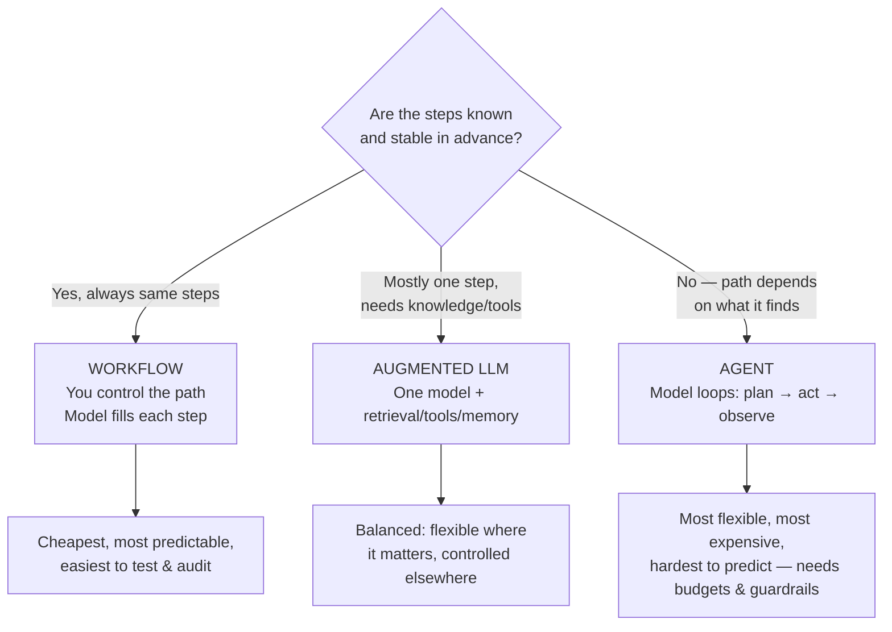
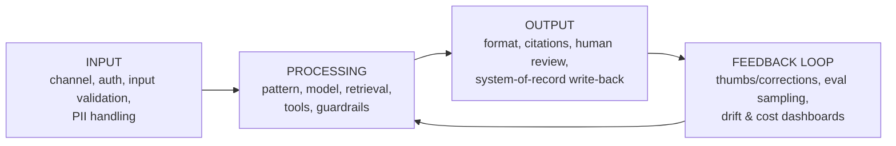

# Module 1 — Claude Solution Architecture: Design Patterns & Multi-Agent Systems
**Course Section 1 (46 min) • Domain 1: Solution Design & Architecture Patterns — 17%**  
*Tool from the course: Solution Design Canvas • Exam Trainer D1 • Flashcards / memory / match games*

---

## 1. The human story

A retailer says: *“We want AI for support.”* A beginner builds “an agent” because agents sound advanced. An architect asks annoying, valuable questions first:

- What outcome? Fewer tickets deflected badly, or faster resolution? What does success *cost* if we're wrong (a wrong refund vs a slow answer)?
- Are the steps known in advance (check order → check policy → draft reply) or genuinely unpredictable (investigate this weird billing dispute)?
- What SLA: answer in 2 seconds or 2 minutes? €0.002 or €0.20 per conversation?

**Lesson:** The pattern (workflow / augmented LLM / agent) is a *business decision with technical consequences* — value, cost, latency, risk. Choosing “agent” by default is the most common Professional-exam trap.

### Learning objectives — by the end you can
1. Turn a vague business ask into a measurable value hypothesis + SLAs.
2. Draw the end-to-end architecture: input → processing → output → feedback loop.
3. Choose workflow vs augmented LLM vs agent *and defend it* on value/cost/latency/risk.
4. Decompose a complex problem and decide when multi-agent helps (and when it's just cost + chaos).
5. Complete a Solution Design Canvas in under 20 minutes.

---

## 2. Beginner foundation: the three patterns

| Pattern | Who decides next step? | Cost/latency behaviour | Testability | Choose when… | Avoid when… |
|---|---|---|---|---|---|
| **Workflow** (prompt chaining, routing, parallelisation, orchestrator-workers with fixed graph, evaluator-optimiser loop with fixed exit) | Developer (predefined graph) | Predictable; sum of known calls | High — test each node | Steps are known, compliance needs auditability, volume is high | Path truly depends on discoveries mid-task |
| **Augmented LLM** | Developer (single call, enriched context) | One (or few) calls; caching-friendly | High | One good answer with grounding/tools suffices (RAG Q&A, extraction + tool) | Task needs multi-step investigation |
| **Agent** | Model (loop with tools, stopping conditions) | Variable; loops multiply tokens/latency | Lower — need trajectory evals, budgets | Open-ended tasks, tool use path unknown, value justifies variance | Steps are actually fixed; cost/latency SLA is tight; risk of unbounded loops |

### Workflow sub-patterns you must recognise (exam vocabulary)
- **Prompt chaining:** A → B → C, each output feeds next (draft → critique → polish). *Risk: error compounds — validate between steps.*
- **Routing:** Classify intent, send to specialised prompt/model/tool (billing → billing flow). *Cheaper + more accurate than one mega-prompt.*
- **Parallelisation:** Fan out independent sub-tasks, merge (section a document per chapter). *Latency ↓, cost same-ish; merging logic matters.*
- **Orchestrator–workers (fixed):** A planner splits *known* work types among workers. (If the planner is freely looping with tools, you're drifting into agent territory.)
- **Evaluator–optimiser:** Generate → score against criteria → revise until threshold/max iterations. *Always cap iterations.*

> 🧠 **Humanised rule:** *Use the simplest pattern that reliably solves the problem. Escalate complexity only with evidence.* In exam answers, “replace the agent with a routed workflow” is very often the defensible choice for cost/latency/reliability failures.

---

## 3. Core concept: from business problem to value

### Step-by-step: the Value-First Design Method

**Step 1 — Name the outcome, not the tech.**  
❌ “Build a Claude agent for HR.” → ✅ “Reduce time-to-first-draft of policy answers from 2 days to 2 hours, with ≥90% citation accuracy, for 400 HR queries/month.”

**Step 2 — Quantify the value lever.**
- **Efficiency:** time saved × volume × loaded cost
- **Cost avoidance:** tickets deflected *correctly* (wrong deflection is negative value!)
- **Quality/revenue:** conversion, CSAT, error reduction, risk avoided

**Step 3 — Set SLAs/SLOs before choosing a model.** Quality (accuracy/citation rate), latency (p50/p95), cost per task, safety (harmful-output rate), availability. *These numbers will decide pattern + model for you in later modules.*

**Step 4 — Map the end-to-end flow.**

Exam stems often omit the feedback loop — the correct answer frequently *adds measurement/feedback* rather than a fancier model.

**Step 5 — Identify constraints & failure costs.** Regulated data? Irreversible actions (payments, deletions)? Peak volume? Offline/batch acceptable? *Failure cost decides human-review placement (Module 6).*

**Step 6 — Choose the pattern with the decision table (§2), write the defence in 3 sentences:** pattern + why + what you'll measure to prove it.

**Step 7 — Decompose.** Break the problem into sub-tasks; for each: pattern, model tier, tools, eval. Complexity you can't decompose, you can't test.

### Worked example (do this on paper)
**Brief:** Law firm, 5,000 contracts, “answer questions about our contracts, fast.”
- Value: associate time saved; failure cost: wrong clause cited → legal risk (HIGH).
- Pattern: **Augmented LLM + RAG** (single grounded answer + citations), *not* an agent — steps are known: retrieve → answer → cite → (low-confidence → human).
- SLA: citation accuracy ≥95% on eval set, p95 < 4s, human review when confidence low or clause is high-risk.
- Feedback: every answer logged with cited chunks; weekly sampled review by paralegals feeds the eval set (Module 5).
*Notice: no agent, no multi-agent — and that's the professional answer.*

---

## 4. Advanced: multi-agent systems — honestly

Multi-agent = multiple specialised agent/worker instances coordinating (supervisor/orchestrator + specialists, handoffs, shared state/memory).

**It genuinely helps when:** sub-tasks need *different* tools/prompts/models, can run in parallel, or benefit from independent critique (generator vs checker with different instructions). Example: research system — searcher, source-critic, synthesiser.

**It hurts when:** it's used to compensate for a vague single prompt. Costs multiply (every handoff is tokens + latency), errors compound, debugging becomes “which agent said that?”, and security surface grows (each agent = identity + tool scope, Module 3).

| Decision question | If YES → | If NO → |
|---|---|---|
| Are sub-tasks independently testable? | Multi-agent candidate | Single agent/workflow |
| Do sub-tasks need different tool scopes? | Separate agents help least-privilege | Keep one, scope tightly |
| Is parallel speed worth extra cost? | Fan-out workers | Sequential workflow |
| Can you eval each agent + the whole? | Proceed, with budgets | Don't ship what you can't measure |

**Non-negotiable controls for any agent/multi-agent design:** max iterations, token/cost budget per task, timeout, tool allow-list, stopping conditions, full trajectory logging, human escalation path. *An exam option that adds agents without budgets/evals is a distractor.*

---

## 5. Hands-On Lab 1 — Pattern Selector & Cost/Latency Simulator

**Run:** `python3 labs/lab01_pattern_selector.py` (see `labs/README.md`)  
You will: model the same task as workflow (3 fixed calls), augmented LLM (1 call + retrieval), and agent (variable loop 3–9 calls); compare illustrative cost/latency distributions; then answer:

1. At what loop-length does the agent breach a 5-second p95 SLA?
2. If volume ×10, which pattern's cost surprises you least? Why?
3. **Break-it exercise:** Set agent loop max = 20. What happens to worst-case cost? Write the guardrail you'd add.

**Deliverable:** One paragraph defending a pattern for *your* chosen scenario (use the Canvas below).

---

## 6. Tool: Solution Design Canvas (copy from `templates/architect-kit.md`)

`Problem | User & volume | Value hypothesis & metric | SLAs (quality/latency/cost/safety) | Pattern & defence | Flow (in/process/out/feedback) | Data & retrieval need | Tools & risk | Eval plan | Top 3 risks`

---

## 7. Exam traps & flashcards

**Traps:** ① Agent-by-default for a fixed process ② Multi-agent to fix a bad prompt ③ No feedback loop/measurement ④ Value stated as tech (“use Claude”) not outcome ⑤ Ignoring failure cost when picking autonomy level.

**Flashcards (cover the right side):**
- Fixed steps + tight latency SLA → ? → *Workflow*
- One grounded answer + citations → ? → *Augmented LLM (RAG)*
- Path depends on findings + budget controls → ? → *Agent*
- First question an architect asks → ? → *“What measurable outcome, at what SLA, at what failure cost?”*

**Trainer:** `practice/domain-trainers.md` → Domain 1 (12 Qs). **Checklist:** ☐ I can defend workflow/augmented/agent in 3 sentences ☐ I can sketch input→output→feedback from memory ☐ I completed the Canvas + Lab 1.

**Next →** [`02-models-prompt-context-engineering.md`](02-models-prompt-context-engineering.md)
