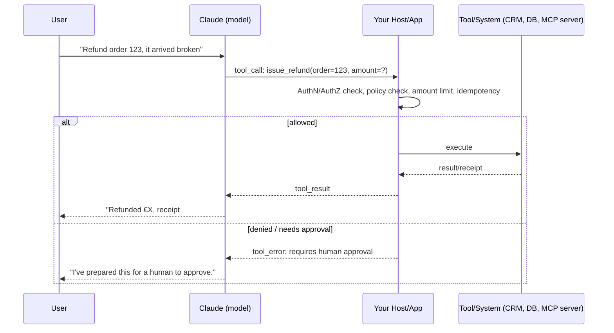

# Module 3 — Claude Integration: MCP, API, Agent-to-Agent & Least Privilege
**Course Section 3 (45 min) • Domain 3: Integration — 19% (part 1 of 2)**  
*Tool from the course: Integration Security Review • Exam Trainer D3 • Study games*

---

## 1. The human story

Your support agent demo goes brilliantly — so someone connects it to *everything*: CRM, payments, refunds, account deletion, internal wiki, email sending. “Just in case.” Three weeks later, a prompt-injection in a customer email persuades it to issue a refund it should never have been *able* to issue. The post-mortem line that matters: **the model didn't fail the security review. There never was one.** The fix was not a cleverer prompt. It was removing tools the role never needed.

This is the **heaviest exam domain (19%)** together with Module 4. Master it.

### Learning objectives
1. Diagnose **capability bloat** and apply least privilege to tools/agents.
2. Close authentication/authorisation gaps for model-invoked actions.
3. Choose **MCP vs API/CLI vs agent-to-agent (A2A)** per connection, with justification.
4. Apply progressive discovery vs monolithic context to tool/context design.
5. Justify accuracy-vs-latency configuration decisions with evidence.

---

## 2. Beginner foundation: how a model “does things”

The model never directly touches your database. It **proposes** a structured tool call; *your* code validates and executes it, then returns a result.

**Golden rule:** *Treat every tool call as an untrusted request from a helpful but persuadable intern.* Validate inputs, authorise the *specific action on the specific resource*, enforce limits server-side — never “the prompt said not to” as your only control.

---

## 3. Core concept 1: Capability bloat & least privilege (the exam's favourite)

**Capability bloat** = an agent holding tools/permissions beyond its role's needs “for convenience/future use”. It increases: blast radius of mistakes/injection, audit scope, cost (tool schemas consume context), and confusion (model picks wrong tool).

**Step-by-step Least-Privilege Review:**
1. **Inventory:** List every tool, per agent, with: action, resource, reversible?, max impact, who/what authorises.
2. **Justify or remove:** For each tool ask: *“Has this role needed this in the last N tasks? What breaks if I remove it?”* No evidenced need → **remove** (don't just “guard it in the prompt”).
3. **Split by risk:** Read-only vs write vs irreversible. Read can be broader; writes get scoped (own customer's orders only), limited (amount caps), and confirmed.
4. **Split agents by scope** where scopes genuinely differ (billing agent ≠ account-admin agent) — this is a *legitimate* multi-agent reason (Module 1).
5. **Scope credentials:** Short-lived, per-agent/service identity, resource-scoped tokens; no shared god-API-key.
6. **Re-review on change:** New tool = security review + eval + ADR (Module 7). Schedule periodic access reviews.

> ✅ **Professional reflex:** When a stem says “agent misused tool X”, the best answer is usually **remove/narrow the capability + server-side authorisation**, not “add a prompt instruction not to misuse X”. Prompts guide; permissions enforce.

## 4. Core concept 2: Identity, authentication & authorisation gaps

| Gap (recognise the wording) | Fix |
|---|---|
| Agent acts with a shared super-user key | Per-agent workload identity, scoped + short-lived credentials, secrets manager, rotation |
| Model can call write tools directly | Host-side AuthZ on every call: *who* (end-user context propagated), *what action*, *which resource*, *what limits* |
| End-user identity lost (“system did it”) | Propagate user identity/claims through the chain; log actor + on-behalf-of; audit trail |
| Tool trusts model-supplied amounts/IDs | Server re-derives/verifies from system of record; never trust model arithmetic for money |
| No confirmation for irreversible actions | Step-up: human approval / explicit user confirmation with summary (Module 6 HITL) |
| Prompt injection via retrieved/tool content | Treat tool/retrieved content as *data, not instructions*; sanitise, privilege-separate, validate outputs (Module 6) |

## 5. Core concept 3: MCP vs API/CLI vs Agent-to-Agent

| Option | What it is (plain) | Choose when | Trade-offs |
|---|---|---|---|
| **Direct API / SDK** | Your app calls a service's API, exposed to the model as your own tool definitions | One/few integrations, tight control, custom logic | You build/maintain each integration; tool schemas in your context |
| **CLI** | Model/app drives a command-line tool | Dev/ops automation, existing CLI tooling, Claude Code-style workflows | Parsing, sandboxing, least-privilege on shell access is critical |
| **MCP (Model Context Protocol)** | Standard protocol: MCP servers expose *tools, resources, prompts* discoverable by MCP clients/hosts | Reusable integrations across apps/agents, ecosystem servers, clean separation of tool provider vs agent | Governance: vet servers, scope permissions, version/pin, monitor — a server is code with access |
| **Agent-to-Agent (A2A-style)** | One agent delegates a sub-task to another agent (with its own prompt/tools) | Specialised, independently-owned/testable capabilities; organisational boundaries | Latency/cost/compounding errors; need contracts, budgets, tracing across agents |

⚠️ *Verify current MCP/A2A spec details officially — protocols evolve fast.* Exam logic stays stable: **match the protocol to reuse, control, and trust boundary; justify the choice.**

**Progressive discovery vs monolithic context:** Dumping 80 tool schemas + a 200-page manual into every prompt is slow, expensive, and confusing. **Progressive discovery:** give the model a small index (tool names/one-liners, doc table of contents), let it request/load detail on demand (tool search, resource fetch). Choose monolithic only when the set is small/stable and always needed. *Exam tell:* stem mentions huge tool list + latency/cost/wrong-tool errors → answer: progressive discovery + trim tools.

**Accuracy vs latency justification:** Every config (bigger model, more retrieved chunks, more tools, extra reasoning) trades latency/cost for (possible) accuracy. Professional answer names the *measurement*: “We tested X vs Y on eval set Z: +1.2% accuracy for +900ms p95 — rejected/accepted because SLA is …”.

---

## 6. Hands-On Lab 3 — Tool-Scope Auditor
**Run:** `python3 labs/lab03_tool_scope_auditor.py` — it loads a bloated support-agent tool inventory (22 tools), flags by risk/usage, and produces a least-privilege recommendation.
1. Which tools does it remove vs scope-down vs gate behind approval? Argue with any you disagree.
2. **Break-it:** Mark `delete_account` as “used once”. Does “used” justify keeping it un-gated? Write the control.
3. Produce your own inventory (template) for a system you know. **Deliverable:** Integration Security Review.

## 7. Exam traps & flashcards
**Traps:** ① Prompt instruction as sole control for dangerous tool ② Shared god-key ③ Adding tools “for future flexibility” ④ MCP server adopted without vetting/scoping ⑤ Monolithic 80-tool context.
**Flashcards:** Misused tool → first fix? → *Remove/narrow capability + server-side AuthZ* • Reusable standard tool exposure → *MCP* • Huge tool set hurting accuracy/latency → *Progressive discovery*.
**Trainer:** Domain 3 (part 1) Qs. **Checklist:** ☐ Tool inventory with risk tiers ☐ Every write tool has AuthZ + limits ☐ Protocol choice justified per integration ☐ Injection treated as data-not-instructions threat.
**Next →** [`04-rag-pipelines-observability.md`](04-rag-pipelines-observability.md)
