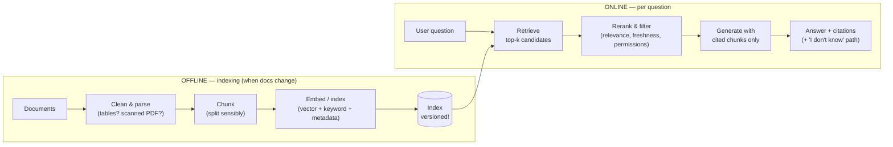

# Module 4 — RAG Pipeline Design: Chunking, Retrieval & Observability
**Course Section 4 (46 min) • Domain 3: Integration — 19% (part 2 of 2)**  
*Tool from the course: RAG & Observability Design • Exam Trainer D3 • Study games*

---

## 1. The human story

Your policy assistant was *right* for two months. Then Legal refreshed the document library — and it began citing the old refund policy with total confidence. The team “fixed the prompt” four times. Nothing helped, because the prompt was never broken: **retrieval was faithfully fetching stale chunks**, and the model did what RAG models do — it answered from what it was given.

> **The RAG diagnostic mantra (memorise):** *When grounded answers go wrong, suspect retrieval before the model, and stale/irrelevant chunks before everything.*

### Learning objectives
1. Design chunking + indexing matched to document shape.
2. Match retrieval (keyword / vector / hybrid) + reranking to query patterns; require citations.
3. Debug RAG failures systematically (stale, irrelevant, missing, mis-ranked chunks).
4. Design observability: what to log, what to alert on, at scale.

---

## 2. Beginner foundation: RAG in one picture



**The open-book exam analogy:** Chunking = making index cards. Indexing = filing them. Retrieval = finding cards. Generation = writing the essay *from the cards, citing them*. If the cards are wrong/stale, the essay is wrong — no matter how smart the writer.

---

## 3. Chunking & indexing (matched to your data)

| Document shape | Chunking strategy | Why / watch-out |
|---|---|---|
| Structured (headings, manuals, policies) | Structure-aware: split on headings/sections, keep heading path as metadata | Preserves meaning; a chunk that starts mid-rule is a bad card |
| Long narrative (reports, books) | Recursive/overlapping windows (e.g., ~several hundred tokens + overlap) — tune by eval | Overlap prevents answers dying at boundaries; too-large chunks dilute relevance |
| Tables / FAQs / tickets | Row/QA-pair as chunk units; keep units intact | Never split a table row from its header |
| Code | By function/class/file with metadata | Symbol-aware retrieval |
| Mixed/ messy PDFs | Parse quality first (OCR, layout) — *garbage in, chunks out* | Budget for parsing; test extraction before blaming embeddings |

**Chunk size trade-off (humanised):** Too small → chunks lack context, answers fragment. Too large → retrieval returns a haystack per needle, cost/latency up, relevance diluted. **There is no magic number — there's your eval (Module 5): test 2–3 strategies on real questions.**

**Indexing essentials:** Store per chunk: text, embedding, source doc + version, section/heading, page, effective/expiry date, access-control tags (who may see it), language. **Version your index and make refresh atomic** (build new index, validate, swap — never half-update in place; that's how old+new policy mix).

## 4. Retrieval, reranking, citations

| Retrieval type | Strength | Weakness | Use |
|---|---|---|---|
| Keyword (BM25-style) | Exact terms, codes, names, SKUs | Misses paraphrase | Error codes, product names, legal phrases |
| Vector (semantic) | Meaning/paraphrase | Can miss exact tokens, “similar but wrong” | Conceptual questions |
| **Hybrid** (both + merge) | Usually best real-world default | More moving parts | Most production RAG — justify with eval |

**Then:** Filter by metadata (date, doc type, **user permissions** — retrieval must enforce access control, Module 6) → **Rerank** top candidates with a more precise scorer, keep top few → Generate **only** from kept chunks → **Cite** chunk IDs per claim → If evidence insufficient: say so / escalate (a system that must always answer will eventually invent).

**Query-side tricks (know the names):** query rewriting/expansion for vague questions, multi-query for complex ones, contextual retrieval (adding doc context to chunks at index time). Each: *test on eval, watch latency/cost.*

## 5. Debugging RAG: the step-by-step fault tree

```
Answer wrong?
├─ 1. Were the RIGHT chunks retrieved?  → Inspect retrieved chunk IDs (you logged them, right?)
│    ├─ Right chunks exist but NOT retrieved → retrieval problem: chunking? embedding? k too small? query form?
│    ├─ Retrieved but ranked low / cut off → reranking / top-k / context budget problem
│    ├─ STALE chunks retrieved → refresh pipeline: versioning, atomic swap, expiry metadata, cache invalidation
│    └─ IRRELEVANT chunks retrieved → hybrid weights, filters, chunk size, query rewriting
├─ 2. Right chunks WERE in context, answer still wrong → generation problem: prompt grounding, model tier, conflicting chunks (dedupe/version conflict)
└─ 3. Right chunks DON'T EXIST → coverage problem: source missing/not parsed/not indexed. No prompt fixes this.
```

**Classic exam scenario decoded:** “Answers degraded *after a document refresh*” → Step 1, stale-chunk branch: **check index refresh/versioning & stale chunk eviction first** — before prompt/model changes. That single reflex earns marks.

## 6. Observability at scale

**Log per request (structured, privacy-aware):** request ID, user/tenant (pseudonymised), query, retrieved chunk IDs + scores + doc versions, rerank outcome, model + prompt version, token counts, latency breakdown (retrieve vs generate), cost, guardrail outcomes, final answer + citations, feedback signal. ⚠️ Log *metadata and IDs*, minimise raw PII in logs (Module 6).

**Dashboard/alert on:** retrieval quality proxies (no-result rate, low-score rate), citation rate, eval-sampled accuracy (daily sampled human/LLM grading), latency p50/p95 by stage, cost per answered query, stale-index age (time since successful refresh), error/tool failure rates, guardrail trigger rates.

**Alert philosophy:** Alert on *user harm* (accuracy proxy dropping, stale index beyond threshold, cost anomaly) — not on every error. Each alert links to a runbook entry (Module 7).

## 7. Hands-On Lab 4 — Build & Break a Mini RAG
**Run:** `python3 labs/lab04_rag_pipeline.py` — chunk a small policy corpus, index with a hashing “embedding” + keyword score (no external services), retrieve, rerank, answer extractively with citations.
1. Ask questions; inspect which chunks were retrieved and cited.
2. **Break-it (the exam scenario):** The lab swaps in a “refreshed” policy *without evicting the old version*. Ask again. Watch it cite stale text. Then enable version filtering/atomic swap and re-run.
3. Experiment: chunk size small vs large — effect on retrieval hits?
**Deliverable:** RAG & Observability Design (template): data shape → chunking → index fields → retrieval/hybrid → rerank → citation policy → refresh/versioning → logs/alerts.

## 8. Exam traps & flashcards
**Traps:** ① Fixing prompt when retrieval is stale ② Bigger top-k as universal cure (more noise/cost) ③ No index versioning/atomic refresh ④ Retrieval ignoring user permissions ⑤ No chunk-level logging (undebuggable).
**Flashcards:** Degraded after refresh → *stale chunks / index versioning* • Exact code lookup → *keyword/hybrid* • Answer wrong + right chunks in context → *generation/grounding*.
**Trainer:** Domain 3 (part 2) Qs. **Checklist:** ☐ Chunking matched to doc shape ☐ Hybrid justified by eval ☐ Refresh is versioned+atomic ☐ Chunk IDs logged per answer.
**Next →** [`05-evaluation-testing-optimisation.md`](05-evaluation-testing-optimisation.md)
