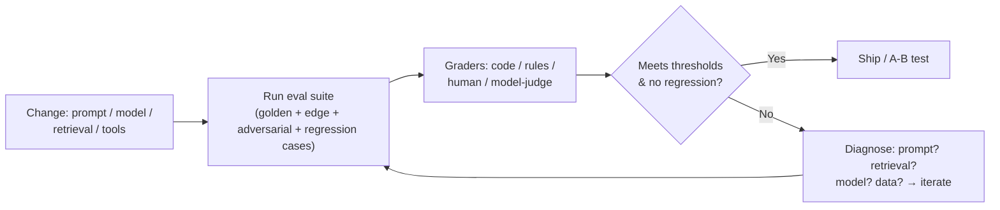

# Module 5 — LLM Evaluation: Evals, A/B Testing, Cost & Latency
**Course Section 5 (46 min) • Domain 4: Evaluation, Testing & Optimisation — 16%**  
*Tool from the course: Eval Plan & Metrics Sheet • Exam Trainer D4 • Study games*

---

## 1. The human story

A team ships a “better” prompt. Vibes say it's better. Two weeks later support tickets quietly rise. Nobody can answer the simplest question — *“better on what, measured how, compared to which version, on which cases?”* — because there was no test set. LLM systems don't usually crash. **They drift, regress silently, and stay fluent while getting worse.** Evals are how you catch that before your users do.

### Learning objectives
1. Write success criteria + metrics with thresholds (accuracy, latency, cost, safety, security).
2. Build an evaluation dataset + graders (code, rule, human, model-as-judge) with mixed methods.
3. Run A/B tests and iterative improvement without fooling yourself.
4. Diagnose prompt failure vs hallucination vs model mismatch; tune token/latency/cost.

---

## 2. Beginner foundation: what an eval actually is

An eval = **(a)** a fixed set of test cases (inputs + expected behaviour), **(b)** a grader that scores outputs, **(c)** a threshold that means pass/fail, **(d)** run automatically on every change.

Analogy: unit tests + a driving exam for your AI. You wouldn't merge code without tests; don't merge prompts without evals. (**Prompt = code.**)

## 3. Metrics that matter (with thresholds — “monitor quality” is not a metric)

| Dimension | Example metric | Example threshold style | Grader |
|---|---|---|---|
| Accuracy/quality | Task success rate; citation correctness; exact-match/F1 for extraction | ≥ X% on golden set, no drop > Y pts vs baseline | Code (structured), human, model-judge w/ rubric |
| Grounding | % claims supported by cited chunks | ≥ X%; unsupported-claim rate ≤ Y% | Model-judge + sampled human |
| Latency | p50/p95 end-to-end & per-stage | p95 ≤ SLA (e.g., 4s) | System measurement |
| Cost | Cost per successful task (not per call!) | ≤ €X; alert on +20% drift | Billing/token logs |
| Safety | Harmful/policy-violating output rate on adversarial set | ≤ near-zero on critical categories | Classifiers + human review |
| Security | Tool-misuse / injection success rate in red-team set | 0 critical successes | Scripted attack cases |
| Robustness | Performance on edge/adversarial/regression subsets *separately* | No subset collapses while average looks fine | Mixed |

> **Pro move:** Report subsets, not just averages. A change that lifts average accuracy but destroys the “angry customer” or “non-English” subset is a regression wearing a disguise.

## 4. Building the test set & graders (step-by-step)

**Step 1 — Start from failures & stakes.** Mine: real user queries (sampled, privacy-safe), support tickets, known failures, stakeholder's scariest cases.
**Step 2 — Compose deliberately (target mix to adapt):** ~40% typical/golden, ~25% edge (ambiguous, long, messy), ~20% regression (every past bug becomes a permanent case), ~15% adversarial/safety (injection, jailbreak, PII probes).
**Step 3 — Write expected behaviour, not just expected text.** For generative tasks: rubric (must cite, must refuse X, must include Y, format = schema).
**Step 4 — Pick graders per case type (mixed methods = exam answer):**
- *Deterministic* (extraction, classification, format): code/rules — cheap, exact.
- *Judgement* (tone, completeness): model-as-judge with rubric + calibration against human labels; sample humans continuously to catch judge drift/bias.
- *High-stakes/safety:* human graders on samples + classifiers at scale.
**Step 5 — Set thresholds & a baseline.** Baseline = current production version's scores. A change must beat/hold baseline + thresholds.
**Step 6 — Automate in CI/CD.** Prompt/model/retrieval change → eval run → report by subset → block on regression.
**Step 7 — Grow it forever.** Every production failure → new regression case *before* fixing. This is the feedback loop from Module 1, made concrete.

⚠️ *Model-as-judge cautions:* judges favour verbosity/own-style outputs; use rubrics, pairwise comparisons where possible, and human calibration. “LLM judged it 95/100” without calibration is a trap answer.

## 5. A/B testing & iterative improvement

1. **Hypothesis first:** “Routing easy cases to fast tier cuts cost 30% with ≤1pt accuracy loss.”
2. **One variable at a time** (or a designed experiment) — change prompt + model + retrieval together and you've learned nothing attributable.
3. **Randomise, size adequately, run long enough** to cover weekday/weekend & segment mix; predefine primary metric + guardrail metrics (don't ship a cost win that tanks safety).
4. **Decide on the pre-registered criteria**, not the prettiest chart found afterwards.
5. **Root-cause regressions properly:** prompt failure (instructions ambiguous — outputs vary wildly), hallucination (fluent but unsupported — grounding/retrieval issue), model mismatch (capability tier wrong for task difficulty — eval by difficulty slice tells you), retrieval failure (Module 4 fault tree). *Each root cause has a different fix; “try a bigger model” is not a diagnosis.*

**Optimisation levers ranked by usual ROI:** remove unnecessary calls/steps → route by difficulty → cache repeated prefixes → trim context/few-shots → right-size output length → *then* model changes. Measure cost per **successful** task throughout.

## 6. Hands-On Lab 5 — Eval Harness & Regression Hunt
**Run:** `python3 labs/lab05_eval_harness.py` — scores two “prompt versions” against a labelled set with code + rubric-style graders, reports per-subset, and flags a hidden regression.
1. Which version wins on average? Which subset regresses? Would your threshold block the ship?
2. **Break-it:** Add a production-style failure case of your own, watch it enter the regression set.
**Deliverable:** Eval Plan & Metrics Sheet (template).

## 7. Exam traps & flashcards
**Traps:** ① “Monitor user feedback” as the whole eval strategy ② Single average metric hiding subset collapse ③ Uncalibrated LLM-judge as sole grader ④ Changing 3 variables then claiming causation ⑤ No regression set from past incidents.
**Flashcards:** Silent quality drift → *eval suite + thresholds in CI* • Fluent unsupported answer → *grounding/hallucination — check retrieval+citations* • Prove a change helped → *baseline vs candidate on same fixed test set / A-B*.
**Trainer:** Domain 4 Qs. **Checklist:** ☐ Metrics have numbers + thresholds ☐ Test set has edge+adversarial+regression slices ☐ Graders mixed & calibrated ☐ Baseline recorded.
**Next →** [`06-governance-safety-compliance.md`](06-governance-safety-compliance.md)
