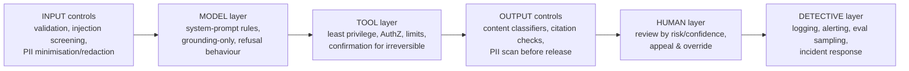

# Module 6 — AI Governance & Safety: Guardrails, Human-in-the-Loop, GDPR, HIPAA, FedRAMP
**Course Section 6 (46 min) • Domain 5: Governance, Safety & Risk Management — 14%**  
*Tool from the course: Guardrail & Compliance Matrix • Exam Trainer D5 • Study games*

---

## 1. The human story

Nobody sets out to build an unsafe system. They build a *capable* one, under time pressure, and safety becomes a paragraph in the prompt: “Please don't do anything harmful.” Then a user pastes a webpage containing hidden instructions, the agent follows them, and the paragraph turns out not to be a control. Governance is the discipline of placing **real controls, at the right layer, proportional to the risk** — and being able to show an auditor the map.

### Learning objectives
1. Enumerate LLM risks/limitations/failure modes for a given system.
2. Place guardrails (preventive / detective / corrective) where the risk actually is.
3. Design human-in-the-loop points by risk, reversibility, and confidence.
4. Map GDPR, HIPAA, FedRAMP needs to architecture; address bias, fairness, transparency.

---

## 2. Risk catalogue (learn to name these in scenarios)

| Risk | Plain meaning | Typical scenario tell |
|---|---|---|
| Hallucination / unsupported claims | Fluent wrong answers | Medical/legal/financial advice without grounding |
| Prompt injection (direct & indirect) | User — or *retrieved/tool content* — smuggles instructions | Pasted email/webpage tells agent to ignore rules |
| Data leakage / PII exposure | Secrets, other users' data, system prompt revealed | Logs full of PII; cross-tenant retrieval |
| Excessive agency | Agent can do too much, irreversibly | Refunds/deletes without approval (Module 3) |
| Bias & fairness harm | Systematic worse treatment of a group | Screening/ranking use cases |
| Unsafe content | Harmful, disallowed, or age-inappropriate output | Open-ended consumer chat |
| Over-reliance / automation bias | Humans rubber-stamp AI output | Reviewer approves everything in 2 seconds |
| Cost/availability abuse | Loops, spam, denial-of-wallet | Unbounded agent loops |
| Model/data drift | Behaviour degrades silently | Module 5's home turf |

**Limitations to state honestly to stakeholders:** models can be confidently wrong, sensitive to phrasing, bounded by context, and only as current as their data/retrieval. Designing *around* limits (grounding, HITL, evals) beats promising them away.

## 3. Guardrails: layered, placed where the risk is

- **Preventive** (stop it happening): least privilege, input validation, grounding constraints.
- **Detective** (catch it fast): output classifiers, monitoring, sampled human audit.
- **Corrective** (limit/repair): rollback, user correction/appeal path, incident playbook, kill switch for agents.

> ✅ Exam reflex: A stem describing a *specific* risk wants the control *at that layer*. Injection via retrieved docs → treat retrieved content as untrusted data + tool-layer AuthZ (not just “stronger system prompt”). Harmful output risk → output classifier + escalation (not just input filtering).

## 4. Human-in-the-loop (HITL) design — step-by-step

1. **Score the action:** impact if wrong × irreversibility × model confidence/evidence quality.
2. **Place review proportionally:**
   - *Low risk, reversible:* automate; sample-audit.
   - *Medium:* automate with post-hoc review queue / spot checks.
   - *High or irreversible:* **pre-action approval** — human sees summary, evidence/citations, and consequence, then approves/edits/rejects.
3. **Design against rubber-stamping:** show uncertainty + sources, require active confirmation for consequential actions, track reviewer agreement rates (100% approval = broken review).
4. **Define SLAs & staffing** for review queues (a HITL step nobody staffs is a bottleneck fiction — Module 7).
5. **Close the loop:** reviewer corrections → eval regression cases (Module 5) + training/guidance updates.

## 5. Compliance mapping (architecture-level, not legal advice)

> ⚠️ This is exam-level architect awareness, **not legal advice**. Engage your compliance/legal teams; verify current requirements officially.

| Framework | Core architectural implications to recognise |
|---|---|
| **GDPR** (EU personal data) | Lawful basis & purpose limitation; **data minimisation** (send model only needed fields); retention/deletion (incl. logs & indexes — can you delete a person's chunks?); data-subject rights (access/erasure); cross-border transfer controls; DPIA for high-risk processing; transparency to users; processor/sub-processor diligence for model providers |
| **HIPAA** (US health data) | PHI safeguards: access control, audit logs, encryption in transit/at rest, minimum-necessary, BAA with vendors before any PHI flows, de-identification where possible, breach procedures. *No BAA + PHI into a tool = architect failure, full stop.* |
| **FedRAMP** (US federal) | Use authorised services at required impact level; boundary, identity (e.g., strong MFA/PIV-style controls), continuous monitoring, incident reporting, data residency/boundary constraints — architecture inherits controls from authorised platform choices |
| **Cross-cutting** | Bias/fairness testing by subgroup, transparency (disclose AI involvement, cite sources, explain limits), records of processing & decision logs (ADRs, Module 7), vendor/model risk assessment |

**Bias/fairness, concretely:** define protected/at-risk groups relevant to your use case (with legal guidance), measure outcome quality *by group* in evals (Module 5 subsets), investigate gaps at data/prompt/model layers, document mitigations. “We told the model to be fair” is not a fairness control.

## 6. Hands-On Lab 6 — Guardrail & Compliance Matrix Builder
**Run:** `python3 labs/lab06_guardrail_matrix.py` — feed it a use case (e.g., “HR screening assistant handling EU candidates + health-adjacent data”) and it scaffolds risks → controls by layer → HITL point → compliance flags for your review.
1. For each generated row: is the control preventive/detective/corrective? At the right layer?
2. **Break-it:** Remove the HITL row for an irreversible action. Who notices, and when? Re-add it with an approval SLA.
**Deliverable:** Completed Guardrail & Compliance Matrix (template) signed off with named owners per control.

## 7. Exam traps & flashcards
**Traps:** ① Prompt-only guardrail for high-risk action ② HITL everywhere (un staffable, ignored) or nowhere (unsafe) ③ PHI/personal data flowing before BAA/minimisation ④ No deletion path for indexed personal data ⑤ Fairness = one prompt sentence.
**Flashcards:** Injection through a document → *retrieved content = untrusted data + tool AuthZ* • Irreversible + high impact → *pre-action human approval* • EU personal data in RAG → *minimise, retention/deletion, access control, DPIA mindset*.
**Trainer:** Domain 5 Qs. **Checklist:** ☐ Every named risk has a layered control + owner ☐ HITL placed by risk×reversibility ☐ Compliance flags mapped before data flows ☐ Appeal/correction path exists.
**Next →** [`07-delivery-stakeholders-claude-code.md`](07-delivery-stakeholders-claude-code.md)
